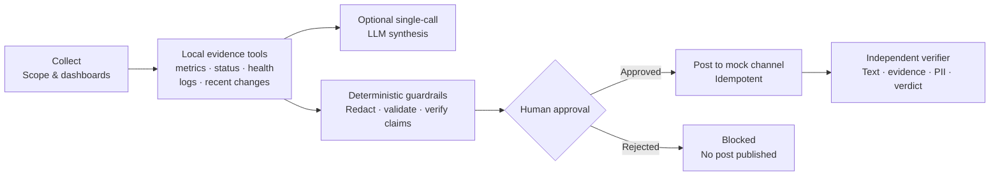

# 🎙️ Incident Voice Status Reporter

During an outage, the on-call lead needs immediate, evidence-backed situational awareness. The **Incident Voice Status Reporter** is a FastAPI-based SRE briefing demo that collects incident scope, evaluates timestamped evidence, and prepares a readable voice brief and team-channel draft. It explicitly declares uncertainty for cached, stale, conflicting, or incomplete evidence, redacts common sensitive-data patterns, requires a run-bound operator approval for mock posting, and independently checks the mock channel ledger afterward.

> [!NOTE]
> **Offline by default:** Fixture mode uses synthetic evidence and makes no provider calls. `OFFLINE_MODE=true` blocks external AI and Grafana requests. A configured Grafana metrics adapter and LLM providers are opt-in; neither has been verified against a live service in this phase. Posts are always written to the local SQLite mock channel, never a real channel.

---

## 🏗️ Architecture & Workflow



1. **Collect**: Validates stable incident identifier and typed scope. Browser dictation is disabled in offline mode because browser speech recognition may use an external service. Dashboard entries are demo identifiers, not URLs fetched by the server.
2. **Plan & Find**: Reads local synthetic fixtures for metrics, status, health, logs, and recent changes. Associates source and retrieval timestamps, computes age, detects cached evidence, and sanitizes PII.
3. **Correlate & Evaluate**: Explicit rule-based decision engine determines operational status (`DEGRADED`, `UNCERTAIN`, `RECOVERED`).
4. **Voice Brief & Proposed Post**: Produces a readable brief and draft where claims cite evidence IDs `[SIG-xxx]`. Audio playback and dictation are disabled in offline mode; the text brief is always available.
5. **Human Approval Gate (Act)**: Operator reviews proposed destination (`#incident-response`) and exact text. Retrying an approved post triggers an idempotency guard preventing duplicate spam.
6. **Independent Verification (Check)**: Separately re-reads the channel to confirm post existence, exact content fidelity, dashboard signal ID linkage, and zero unredacted PII.

### Agent mode and evidence tools

The provider-backed synthesis agent runs only when both `OFFLINE_MODE=false` and `LIVE_LLM_ENABLED=true`; a key alone never enables network access. `LLM_PROVIDER=gemini` uses the pinned `google-genai` SDK; `LLM_PROVIDER=openai_compat` uses a configured chat-completions endpoint at `LLM_BASE_URL`. The server gathers all five read-only evidence tools locally in one batch, records each tool observation in the trace, and sends the combined evidence in one model request. A guardrail repair can make one additional request. Local recordings can be replayed with `DEMO_MODE=true` even while external providers are offline.

| Tool | Synthetic source |
|---|---|
| `get_dashboard_metrics` | Grafana-style error rate, latency, saturation |
| `get_status_page` | Status page state and update time |
| `get_health_check` | Health probe and failure state |
| `get_logs` | Log summaries redacted before model context |
| `get_recent_changes` | Deployment/configuration changes |

The five local tools execute before model synthesis, so a normal run uses one provider request; a guardrail repair may use one additional request. Gemini quota errors can trigger a configured OpenAI-compatible fallback. The test runner uses rules or recorded responses by default; live use is opt-in. Trace rows retain each local evidence observation and guardrail outcome. “Thought summaries” are fixed safety summaries; private chain-of-thought is not requested or stored.

Confidence is deterministic rather than model-selected: `0.65 × fresh-signal ratio + 0.25 × cross-source agreement + 0.10 × required-source coverage` (metrics, health, logs). The UI displays this formula alongside the score.

---

## ⚖️ Operational Decision Rules

| Condition | Evaluated Signals | Resulting State | System Rationale & Behavior |
|:---|:---|:---:|:---|
| **Cached Signal** | Any signal with `is_cached = True` | **`UNCERTAIN`** | Explicitly states: *"This is not proof of recovery."* Edge-cache hits cannot verify active system health. |
| **Stale Signal** | Signal age $> 300$ seconds (5 minutes) | **`UNCERTAIN`** | Telemetry is outdated; state is uncertain until fresh metrics arrive. |
| **Missing Evidence** | Required metric or health probe absent | **`UNCERTAIN`** | Never guesses. If required evidence is missing, returns uncertain. |
| **Unavailable Log Source** | Log evidence is absent | **`UNCERTAIN`** | Missing evidence is called out rather than treated as a clean result. |
| **Failing Health Probe** | Health check fails (e.g. 500/503), even if metrics are green | **`UNCERTAIN`** | Explicitly states: *"Recovery uncertain."* Probe failures override low error rates. |
| **Degraded Telemetry** | All signals fresh, probe passing, error rate $> 1.0\%$ | **`DEGRADED`** | System is actively impaired and experiencing elevated errors. |
| **Full Recovery** | All signals fresh, probe passing, error rate $\le 1.0\%$ | **`RECOVERED`** | All telemetry normal, verified, and healthy. |

---

## 🧪 Official Test Cases Matrix (TC1 to TC4)

The four official cases plus Mixed Signals and Missing Evidence are reproducible:

| Test Case | Scenario | Input Description | Expected Result | Actual Result | Traceable Evidence |
|:---|:---|:---|:---|:---|:---|
| **TC1** | **Status update** | Scope: Checkout 500 errors<br>Signals: 14.8% error rate, 920ms latency, Outage status | Voice brief begins with timestamp; claims cite source/evidence IDs and include source/retrieval time and freshness; state is `DEGRADED`. | Verified by the TC1 pytest and six-scenario API runner. | Synthetic IDs include `[SIG-METRIC-ERR]`, `[SIG-STAT-01]`, `[SIG-HLTH-01]`, and `[SIG-LOG-01]`. |
| **TC2** | **Cached and stale dashboard** | Scope: Post-restart recovery<br>Signals: 0.1% cached error rate; separate test uses HTTP 200 metadata with a 600-second-old source time | State is `UNCERTAIN`; stale/cached evidence is not proof of recovery. | Cached and stale test cases pass. | The HTTP 200 case is a synthetic fixture test, not a live Grafana request. |
| **TC3** | **Customer data in logs** | Scope: Payment failure logs<br>Logs: Synthetic emails, phones, card-like values, API/access credentials and authorization headers | Sensitive values replaced with `[REDACTED_*]` in evidence, briefs, proposed posts, and exported reports. | TC3 and exported-report regression tests pass. | Heuristic patterns cannot detect every possible secret. |
| **TC4** | **Health check failing** | Scope: Post-failover check<br>Signals: 0.2% errors and `Operational` status alongside DB probe failure (503) | State is `UNCERTAIN`; failing health probe blocks recovery and contradictory observations remain visible. | TC4 rule and API scenario tests pass. | Synthetic evidence includes `[SIG-METRIC-ERR]`, `[SIG-STAT-01]`, and `[SIG-HLTH-01]`. |
| **MIXED** | **Mixed signals** | Elevated metrics but status page says resolved | `DEGRADED`; explain conflict | Fresh error-rate metric overrides the status page claim | `SIG-METRIC-ERR` and `SIG-STAT-01` |
| **MISSING** | **Missing evidence** | Log source unavailable | `UNCERTAIN`; explain missing source | Missing-log rule forces uncertainty | No log signal returned by `get_logs` |

---

## 🛡️ Safety & Security Principles

- **Synthetic fixtures**: Inputs, evidence, and channel posts are mock data. The dashboard values are not live observations.
- **Privacy & PII Protection**: Regex-based redaction runs at ingestion and output boundaries. It covers common email, phone, payment-card, authorization-header, and token formats; it is not a universal secret detector.
- **Run-bound Human Approval**: The agent cannot post autonomously. Approval is persisted once per agent run and binds the exact destination and message; rejection cannot be reversed on that run. Editing an unposted approved draft invalidates the approval and requires a new run.
- **Idempotency & Duplicate Prevention**: Mock posts use a SHA-256 key over incident, destination, and exact message. Exact retries of an approved run do not duplicate posts.
- **API authentication**: Sensitive reads and state-changing routes require an environment-provisioned bearer token. Operator tokens can analyze, approve/reject, and verify; admin tokens are also required for test runs and mock-channel reset. No password or cookie session is used. Tokens do not expire automatically and represent roles rather than individual identities; use TLS and a production identity provider before operational deployment.
- **No CAPTCHA / OTP Bypass**: The system operates purely on permitted internal telemetry and never attempts to bypass security controls or authentication gates.
- **Transparent Verification**: Independent verification runs post-action and keeps any pending or failed checks visible.

---

## 🚀 Setup & Execution

### Prerequisites
- Python 3.11+
- Chrome or Microsoft Edge (recommended)

> [!IMPORTANT]
> **Browser Speech API Compatibility:** Dictation and speech playback are disabled in offline mode to avoid browser-managed external speech services. When explicitly running non-offline, the APIs may require **Google Chrome** or **Microsoft Edge** over `localhost` or `HTTPS`.

### 1. Installation
```bash
# Clone the repository and enter directory
cd voice

# Optional: create and activate a virtual environment
python -m venv .venv
# Windows PowerShell: .\.venv\Scripts\Activate.ps1
# macOS/Linux: source .venv/bin/activate

# Install pinned dependencies
pip install -r requirements.txt
```

### 2. Environment Configuration
```bash
# Copy template (optional, sensible defaults apply automatically)
cp .env.example .env
# Windows PowerShell equivalent: Copy-Item .env.example .env
```
| Variable | Default | Description |
|---|---|---|
| `LLM_PROVIDER` | `gemini` | `gemini` or `openai_compat` |
| `LLM_API_KEY` | empty | Provider key; keep it in Render Secrets, never in source |
| `LLM_MODEL` | `gemini-2.5-flash` | Model name. Gemini's model guide lists this as a low-latency, price-performance model. |
| `LLM_BASE_URL` | empty | Required for an OpenAI-compatible endpoint; base URL without `/chat/completions` |
| `LLM_TIMEOUT_SECONDS` | `12` | Provider request timeout; Gemini requires at least 10 seconds |
| `OFFLINE_MODE` | `true` | Blocks external AI and Grafana requests regardless of configured keys |
| `LIVE_LLM_ENABLED` | `false` | Second explicit gate; live AI requires this and `OFFLINE_MODE=false` |
| `OPERATOR_TOKEN` | empty | Bearer token for protected operator routes |
| `ADMIN_TOKEN` | empty | Separate bearer token for admin-only test runs and channel reset |
| `LLM_FALLBACK_PROVIDER` | empty | Optional `openai_compat` provider used only on primary quota errors |
| `LLM_FALLBACK_API_KEY` | empty | API key for the quota failover provider |
| `LLM_FALLBACK_MODEL` | empty | Failover model identifier |
| `LLM_FALLBACK_BASE_URL` | empty | Failover OpenAI-compatible base URL |
| `DB_PATH` | `incident_reporter.db` | Writable SQLite location; configure a Render disk path for persistence |
| `EVIDENCE_SOURCE` | `fixtures` | `fixtures` (offline synthetic scenarios) or `grafana` (only explicitly configured query source) |
| `GRAFANA_PROMETHEUS_QUERY_URL` | empty | Authorized HTTPS Grafana datasource proxy endpoint returning Prometheus instant-query JSON; HTTP only on loopback |
| `GRAFANA_SOURCE_ID` | `configured-grafana` | Operator-supplied identifier stored with each evidence item |
| `GRAFANA_API_KEY` | empty | Optional bearer token sent in the Authorization header only to the configured endpoint |
| `GRAFANA_TIMEOUT_SECONDS` | `5` | Bounded source timeout from 0.1 to 30 seconds |
| `GRAFANA_METRIC_QUERIES` | empty | JSON mapping of supported metric names (`error_rate`, `latency_ms`, `saturation`) to approved PromQL expressions |
| `DEFAULT_CHANNEL` | `#incident-response` | Mock channel only |
| `DEMO_MODE` | `false` | Replays one validated recorded response per scenario; never makes a live request |
| `RECORD_LLM` | `false` | Saves validated (redacted) live responses by scenario to the recordings JSON file |
| `LLM_RECORDINGS_PATH` | `data/llm_recordings.json` | Path used for recorded-response replay |
| `CORS_ALLOW_ORIGINS` | empty | Comma-separated origins; CORS is off unless configured |
| `HOST`, `PORT` | `0.0.0.0`, platform-provided | Server bind address and port |

Grafana mode is opt-in and does not use fixture fallback. Configure only an authorized endpoint and approved queries. If configured, the API key is sent in an Authorization header only to that endpoint; redirects are not followed, and endpoint URLs with embedded credentials or pre-existing query parameters are rejected. The instant-query parser has mocked coverage for success, timeout, HTTP failure, malformed/missing samples and timestamps. No live endpoint, credential, or response format has been verified. Grafana mode supplies metrics only; health, status, logs, and changes remain unavailable, so metrics alone cannot confirm recovery.

### Authentication and offline local setup

Generate two distinct high-entropy tokens and configure them only in `.env` or a secret manager:

```powershell
python -c "import secrets; print(secrets.token_urlsafe(32))"
```

Set the values as `OPERATOR_TOKEN` and `ADMIN_TOKEN`. Protected routes fail closed with HTTP 503 if neither token is configured. The browser holds a token only in page memory and sends it as a bearer header; it is not stored in a cookie or local storage. Tokens are static and do not expire automatically; they identify a role, not an individual user.

### 3. Run Pytest Suite
```bash
pytest -v
```
The pytest suite is offline: source/provider HTTP calls are mocked, fixtures are synthetic, and each test gets an isolated SQLite database. The `/api/run-tests` runner executes TC1-TC4 plus Mixed and Missing through the full pipeline, labels its approval simulation as test-only, and reports PASS only when assertions and independent mock-channel verification pass. Live model requests are off by default in the test runner; enable the UI's **Run with live LLM** option only when intended. With `DEMO_MODE=true`, the runner uses matching recorded responses when available and falls back to deterministic rules otherwise.

Identical analysis inputs are cached in-process for ten minutes, and the UI labels cache hits. On a Gemini quota error, `LLM_FALLBACK_PROVIDER=openai_compat` can route the request through separately configured fallback credentials/model/base URL before rules fallback. Full provider diagnostics are logged server-side; the UI receives only a short status. `DEMO_MODE=true` replays a local recorded response without an external request, including while `OFFLINE_MODE=true`.

### 4. Start Server
```bash
uvicorn app.main:app --host 127.0.0.1 --port 8000 --reload
```
Open **http://127.0.0.1:8000** and enter the admin token in the page. The example configuration defaults to offline fixtures. A provider key alone never enables external requests; live AI needs both explicit flags, and Grafana access additionally needs an authorized configured endpoint.

*(The SQLite database is created and pre-seeded automatically on first start with no manual steps required).*

---

## ☁️ Deployment Instructions

The repository has a container file and `Procfile`; durable hosting still requires the operator to configure persistent storage:

### Render / Railway / Heroku
A [`Procfile`](./Procfile) is provided:
```
web: uvicorn app.main:app --host 0.0.0.0 --port $PORT
```
For Render, create a Web Service connected to this repository, use `pip install -r requirements.txt` as the build command, and use the `Procfile` start command (or `uvicorn app.main:app --host 0.0.0.0 --port $PORT`). Set the health-check path to `/health` if configuring one. Set secrets in the service environment, not in Git. For persistent SQLite and recordings, attach a persistent disk if the selected plan supports it and point `DB_PATH` and `LLM_RECORDINGS_PATH` at its mount path. This repository does not declare a Render disk or assume the plan includes one. For Gemini, set `LLM_PROVIDER`, `LLM_API_KEY`, and `LLM_MODEL`. To enable quota failover, add the `LLM_FALLBACK_*` variables. No deployment was performed as part of this work.

### Docker / Hugging Face Spaces
Build and run using the [`Dockerfile`](./Dockerfile) (`python:3.11-slim`):
```bash
docker build -t incident-voice-reporter .
docker run -p 8000:8000 incident-voice-reporter
```

---

## 🎬 3-Minute Demo Walkthrough for Judges

Follow this rapid step-by-step script at `http://localhost:8000`:

1. **TC1 — Status Update (Timestamps & Linked Claims)**:
   - Click **`TC1: Status Update`** $\rightarrow$ Click **`⚡ Collect Signals & Plan Voice Brief`**.
   - Show that status is **`DEGRADED`** (error rate 14.8%).
   - Point out that the voice brief begins with an exact UTC timestamp (`At HH:MM:SS UTC, incident voice update for...`).
   - Show that each claim in the matrix links to its dashboard ID (`[SIG-METRIC-ERR]`, `[SIG-STAT-01]`).
   - Click **`🔊 Read Aloud`** to demonstrate browser TTS with the audio wave animation.

2. **TC2 — Cached Dashboard ("Not Proof of Recovery")**:
   - Click **`TC2: Cached Dashboard`** $\rightarrow$ Click **`⚡ Collect Signals & Plan Voice Brief`**.
   - Show that even though errors are 0.1%, the edge cache flag causes state **`UNCERTAIN`**.
   - Point out explicit warning: **`"This is not proof of recovery."`**

3. **TC4 — Health Check Failing ("Recovery Uncertain")**:
   - Click **`TC4: Health Check Failing`** $\rightarrow$ Click **`⚡ Collect Signals & Plan Voice Brief`**.
   - Show that metrics look green (0.2%), but failing DB replication probe forces state **`UNCERTAIN`**.
   - Point out explicit warning: **`"Recovery uncertain."`**

4. **TC3 — Customer Data in Logs (Automated Redaction)**:
   - Click **`TC3: Customer Data in Logs`** $\rightarrow$ Click **`⚡ Collect Signals & Plan Voice Brief`**.
   - Show that raw payment exception logs contain emails, phone numbers, and credit cards.
   - Show that all sensitive tokens are redacted into `[REDACTED_EMAIL]`, `[REDACTED_PHONE]`, `[REDACTED_CARD]` across evidence, voice, proposed post, and database rows.

5. **Try to Trick the Agent**:
   - Select TC2, enable **Try to trick the agent**, and run it.
   - Show the simulated recovery claim rejected by guardrails and the deterministic uncertain brief retained.

6. **Human Approval & Duplicate Post Prevention (Idempotency)**:
   - Review proposed update for `#incident-response`.
   - Click **`✅ Approve & Post`** $\rightarrow$ the approved message is written to the clearly labelled Mock Channel Feed and independent verification checks the recorded post. This is not a real external publish.
   - Click **`🔄 Retry (Test Idempotency)`** $\rightarrow$ show duplicate alert; duplicate channel spam is blocked.

7. **Test Matrix**:
   - Leave **Run with live LLM** unchecked and click **`▶️ Run All Official Test Cases`** to show six synthetic scenarios with rules/recorded output, test-only approval, and verification.
   - Download the run's evidence pack from the console.

---

## Known limitations

- Fixture telemetry and the mock channel are synthetic/local. The optional Grafana-compatible adapter supports configured metric queries only and has mocked response coverage; no live endpoint or credential was used.
- The local SQLite channel is not an external messaging integration. Approval, rejection, persistence-failure handling, duplicate prevention, and read-back verification are tested against that mock ledger only.
- Protected routes use static environment bearer tokens. They do not expire, identify named users, or provide a revocation endpoint. Use TLS and a production identity provider before operational deployment.
- The Grafana endpoint must be explicitly configured and authorized. Credential-bearing endpoint URLs and existing query parameters are rejected, authenticated requests do not follow redirects, and no live Grafana credential flow has been verified.
- Provider integration is tested with mocked clients; live provider availability and quotas remain unverified. `OFFLINE_MODE=true` is the default and fails closed even if its value is unrecognized.
- Demo recordings are stored in a JSON file and must be placed on persistent storage to survive deployment restarts. Only accepted, guardrail-passing live outputs are recorded.
- Agent progress is shown after the synchronous run completes; the current UI does not stream intermediate model/tool steps over SSE.
- SQLite on ephemeral hosting is not durable without a mounted persistent disk.
- In-process analysis caching is not shared across workers or server restarts.
- Regex redaction reduces common leaks but cannot guarantee detection of every secret format.
- Browser microphone and speech output are disabled in offline mode; visible text is always available.

---

## 📄 License
MIT License. Created for the Incident Voice Status Reporter Hackathon.
