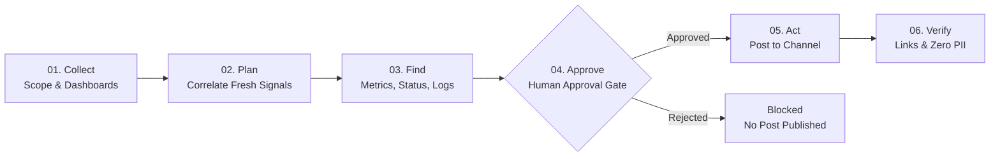

# 🎙️ Incident Voice Status Reporter

During an outage, the on-call lead needs immediate, verified situational awareness without clicking through dozens of fragmented dashboards or risking customer privacy. The **Incident Voice Status Reporter** is an automated SRE briefing agent that collects incident scope, correlates fresh signals across Grafana dashboards, status pages, metrics, and logs, and speaks a concise voice status brief while drafting an update for the team channel. The agent explicitly declares uncertainty when signals are cached, stale, or conflicting, automatically masks sensitive customer data (PII) before display or speech, strictly gates all outbound actions behind human approval, and independently verifies that every claim links directly to a verifiable dashboard ID.

> [!NOTE]
> **Simulated & Synthetic Data Notice:** All telemetry sources (Grafana dashboards, status pages, database replication probes, error logs) and customer identity data (names, emails, phone numbers, credit cards) are **100% synthetic, locally simulated mock records**. No real customer accounts, third-party credentials, paid plans, or external network connections are used or required.

---

## 🏗️ Architecture & Workflow



1. **Collect**: Validates stable incident identifier, scope text (typed or dictated via browser SpeechRecognition), and target monitoring dashboards.
2. **Plan & Find**: Pulls telemetry from status pages, metrics, and logs. Associates retrieval timestamps, computes age, detects edge caches, and sanitizes PII.
3. **Correlate & Evaluate**: Explicit rule-based decision engine determines operational status (`DEGRADED`, `UNCERTAIN`, `RECOVERED`).
4. **Voice Brief & Proposed Post**: Produces an audio brief (using browser SpeechSynthesis) where every claim cites its supporting dashboard ID `[SIG-xxx]`.
5. **Human Approval Gate (Act)**: Operator reviews proposed destination (`#incident-response`) and exact text. Retrying an approved post triggers an idempotency guard preventing duplicate spam.
6. **Independent Verification (Check)**: Separately re-reads the channel to confirm post existence, exact content fidelity, dashboard signal ID linkage, and zero unredacted PII.

---

## ⚖️ Operational Decision Rules

| Condition | Evaluated Signals | Resulting State | System Rationale & Behavior |
|:---|:---|:---:|:---|
| **Cached Signal** | Any signal with `is_cached = True` | **`UNCERTAIN`** | Explicitly states: *"This is not proof of recovery."* Edge-cache hits cannot verify active system health. |
| **Stale Signal** | Signal age $> 300$ seconds (5 minutes) | **`UNCERTAIN`** | Telemetry is outdated; state is uncertain until fresh metrics arrive. |
| **Missing Evidence** | Required metric or health probe absent | **`UNCERTAIN`** | Never guesses. If required evidence is missing, returns uncertain. |
| **Failing Health Probe** | Health check fails (e.g. 500/503), even if metrics are green | **`UNCERTAIN`** | Explicitly states: *"Recovery uncertain."* Probe failures override low error rates. |
| **Degraded Telemetry** | All signals fresh, probe passing, error rate $> 1.0\%$ | **`DEGRADED`** | System is actively impaired and experiencing elevated errors. |
| **Full Recovery** | All signals fresh, probe passing, error rate $\le 1.0\%$ | **`RECOVERED`** | All telemetry normal, verified, and healthy. |

---

## 🧪 Official Test Cases Matrix (TC1 to TC4)

All four official scenarios are reproducible and verified via pytest and the built-in test runner:

| Test Case | Scenario | Input Description | Expected Result | Actual Result | Traceable Evidence |
|:---|:---|:---|:---|:---|:---|
| **TC1** | **Status update** | Scope: Checkout 500 errors<br>Signals: 14.8% error rate, 920ms latency, Outage status | Voice brief begins with timestamp; claims cite dashboard IDs; state is `DEGRADED`. | Brief starts with `At HH:MM:SS UTC`; citations `[SIG-METRIC-ERR]`, `[SIG-STAT-01]`; state: `DEGRADED`. | 5 fresh signals with updated timestamps. |
| **TC2** | **Cached dashboard** | Scope: Post-restart recovery<br>Signals: 0.1% error rate with `is_cached = True` | State is `UNCERTAIN`; outputs *"not proof of recovery"*. | State: `UNCERTAIN`; voice brief and post declare *"This is not proof of recovery."* | Cache flag detected on `SIG-METRIC-ERR` (age > 400s). |
| **TC3** | **Customer data in logs** | Scope: Payment failure logs<br>Logs: Contains emails, phone numbers, credit cards | Sensitive data replaced with `[REDACTED_*]` across all surfaces. | Emails, phones, cards masked into `[REDACTED_*]`; 0 raw PII leaked in brief, post, or database rows. | Regex sanitizer masked 4 PII occurrences before storage. |
| **TC4** | **Health check failing** | Scope: Post-failover check<br>Signals: 0.2% errors (green), but DB probe fails (503) | State is `UNCERTAIN`; brief says *"recovery uncertain"*. | State: `UNCERTAIN`; voice brief and post declare *"recovery uncertain"*. | Deep probe `SIG-HLTH-01` returned HTTP 503 replica lag. |

---

## 🛡️ Safety & Security Principles

- **100% Mock & Synthetic Data**: All metrics, endpoints, and customer data are locally generated synthetic examples.
- **Privacy & PII Protection**: Regex-based redaction engine executes at ingestion time. Emails (`[REDACTED_EMAIL]`), phone numbers (`[REDACTED_PHONE]`), and payment cards (`[REDACTED_CARD]`) are masked *before* speech, display, or database writes.
- **Mandatory Human Approval**: The agent cannot post autonomously. An operator must click `Approve`. A rejected update publishes nothing.
- **Idempotency & Duplicate Prevention**: Outbound messages are hashed via SHA-256 `hash(incident_id + message)`. Retrying an approval executes safely without creating duplicate posts in the channel.
- **No CAPTCHA / OTP Bypass**: The system operates purely on permitted internal telemetry and never attempts to bypass security controls or authentication gates.
- **Transparent Verification**: Independent verification runs post-action and keeps any pending or failed checks visible.

---

## 🚀 Setup & Execution

### Prerequisites
- Python 3.11+
- Chrome or Microsoft Edge (recommended)

> [!IMPORTANT]
> **Browser Speech API Compatibility:** In-browser Speech-to-Text (`SpeechRecognition`) and Text-to-Speech (`speechSynthesis`) require **Google Chrome** or **Microsoft Edge** running over `localhost` or an `HTTPS` connection.

### 1. Installation
```bash
# Clone the repository and enter directory
cd voice

# Install pinned dependencies
pip install -r requirements.txt
```

### 2. Environment Configuration (Optional)
```bash
# Copy template (optional, sensible defaults apply automatically)
cp .env.example .env
```
Supported environment variables:
- `PORT`: HTTP port (default: `8000`)
- `HOST`: Bind address (default: `0.0.0.0`)
- `DB_PATH`: SQLite database file path (default: `incident_reporter.db`)
- `DEFAULT_CHANNEL`: Mock channel destination (default: `#incident-response`)

### 3. Run Pytest Suite
```bash
pytest -v
```
*Result: All 17 automated tests pass (TC1 to TC4, missing evidence, approval gate, idempotency, verification, health endpoint, and API smoke tests) using an isolated temporary SQLite database.*

### 4. Start Server
```bash
uvicorn app.main:app --host 0.0.0.0 --port 8000 --reload
```
Open your browser at: **[http://localhost:8000](http://localhost:8000)**

*(The SQLite database is created and pre-seeded automatically on first start with no manual steps required).*

---

## ☁️ Deployment Instructions

The application is cloud-ready and includes container and process manifests:

### Render / Railway / Heroku
A [`Procfile`](file:///c:/Users/ps213/OneDrive/Desktop/voice/Procfile) is provided:
```
web: uvicorn app.main:app --host 0.0.0.0 --port $PORT
```
Health check endpoint: `GET /health` returns `{"status": "ok"}`.

### Docker / Hugging Face Spaces
Build and run using the [`Dockerfile`](file:///c:/Users/ps213/OneDrive/Desktop/voice/Dockerfile) (`python:3.11-slim`):
```bash
docker build -t incident-voice-reporter .
docker run -p 8000:8000 incident-voice-reporter
```

---

## 🎬 3-Minute Demo Walkthrough for Judges

Follow this rapid step-by-step script at `http://localhost:8000`:

1. **TC1 — Status Update (Timestamps & Linked Claims)**:
   - Click **`TC1: Status Update`** $\rightarrow$ Click **`⚡ Collect Signals & Plan Voice Brief`**.
   - Show that status is **`DEGRADED`** (error rate 14.8%).
   - Point out that the voice brief begins with an exact UTC timestamp (`At HH:MM:SS UTC, incident voice update for...`).
   - Show that each claim in the matrix links to its dashboard ID (`[SIG-METRIC-ERR]`, `[SIG-STAT-01]`).
   - Click **`🔊 Read Aloud`** to demonstrate browser TTS with the audio wave animation.

2. **TC2 — Cached Dashboard ("Not Proof of Recovery")**:
   - Click **`TC2: Cached Dashboard`** $\rightarrow$ Click **`⚡ Collect Signals & Plan Voice Brief`**.
   - Show that even though errors are 0.1%, the edge cache flag causes state **`UNCERTAIN`**.
   - Point out explicit warning: **`"This is not proof of recovery."`**

3. **TC4 — Health Check Failing ("Recovery Uncertain")**:
   - Click **`TC4: Health Check Failing`** $\rightarrow$ Click **`⚡ Collect Signals & Plan Voice Brief`**.
   - Show that metrics look green (0.2%), but failing DB replication probe forces state **`UNCERTAIN`**.
   - Point out explicit warning: **`"Recovery uncertain."`**

4. **TC3 — Customer Data in Logs (Automated Redaction)**:
   - Click **`TC3: Customer Data in Logs`** $\rightarrow$ Click **`⚡ Collect Signals & Plan Voice Brief`**.
   - Show that raw payment exception logs contain emails, phone numbers, and credit cards.
   - Show that all sensitive tokens are redacted into `[REDACTED_EMAIL]`, `[REDACTED_PHONE]`, `[REDACTED_CARD]` across evidence, voice, proposed post, and database rows.

5. **Human Approval & Duplicate Post Prevention (Idempotency)**:
   - Review proposed update for `#incident-response`.
   - Click **`✅ Approve & Post`** $\rightarrow$ message publishes to the Mock Channel Feed and independent verification reports **`PASS 4/4`**.
   - Click **`🔄 Retry (Test Idempotency)`** $\rightarrow$ show duplicate alert; duplicate channel spam is blocked.

6. **Speech Dictation & Test Matrix**:
   - Click **`🎙️ Dictate`** to demonstrate speech-to-text in the scope field (editable live).
   - Click **`▶️ Run All Official Test Cases`** to show the live execution matrix running TC1–TC4 with traceable results.

---

## 📄 License
MIT License. Created for the Incident Voice Status Reporter Hackathon.
