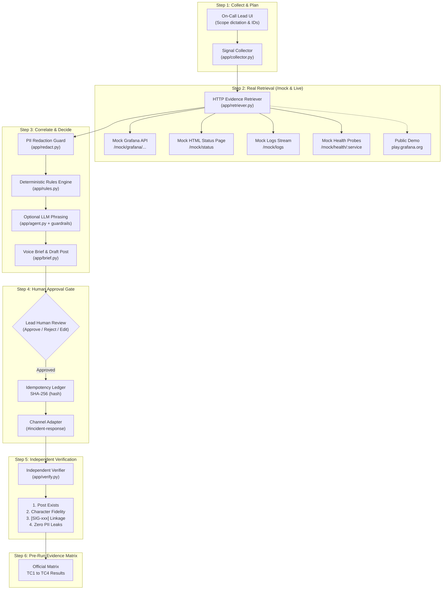

# 🎙️ Incident Voice Status Reporter

An operational SRE AI agent built for the **Agentic AI Hackathon 2026** (Industry: Developer & Enterprise AI). During an outage, the on-call lead gets instant, evidence-backed voice briefs from observability dashboards, status pages, health probes, and log streams.

Live Demo Deployed at: [https://incident-voice-status-reporter.onrender.com/](https://incident-voice-status-reporter.onrender.com/)

---

## 🎯 Problem Statement Fulfillment

During an incident, human operators cannot afford to context-switch across dozens of dashboards, status pages, and logs. This project fulfills all requirements of the hackathon specification:

1. **Collect Details:** Validates incident scope and stable identifiers with browser SpeechRecognition dictation.
2. **Retrieve Real Telemetry:** Interrogates an observability backend (`/mock` or `play.grafana.org`) over real HTTP, parsing JSON metrics and HTML status pages.
3. **Pure Deterministic Decision Rules:** Evaluates evidence freshness, detects cached/stale data (never claiming recovery prematurely), flags failing health probes, and explains conflicts. The LLM only phrases the brief; deterministic guardrails strictly decide operational state (`DEGRADED`, `UNCERTAIN`, `RECOVERED`).
4. **Human Approval Gate:** Requires explicit human approval before publishing any update to `#incident-response`. Enforces character-exact fidelity and SHA-256 idempotency.
5. **Independent Verification:** Re-reads the persistent channel ledger post-action, verifies content fidelity, traces every claim to a source `[SIG-xxx]` identifier, and checks zero customer data (PII) leakage.
6. **Voice Synthesis & Control:** Concise structured voice briefs (20–40s), sentence-by-sentence text highlighting in sync with audio, voice selection, Hindi voice toggle, and a hands-free voice assistant mode.

---

## 🏗️ Architecture & Workflow



---

## 🗺️ Problem Statement to Code & UI Mapping

| Official Requirement | Implementation File(s) | UI Step & Section |
|:---|:---|:---|
| **(1) Set up inputs with stable IDs & validation** | `app/collector.py`, `app/main.py` | **Step ①: Scope & Sources** (`#incidentId`, `#scopeInput`, Web Speech dictation) |
| **(2) Real retrieval from Grafana & HTML status** | `app/mock_observability.py`, `app/retriever.py` | **Step ②: Telemetry Evidence Table** (HTTP status, latency, age, status) |
| **(3) Deterministic decision rules & uncertainty** | `app/rules.py` | **Step ③: Rules Fired Panel** (Auditable Rule IDs, threshold, evidence evaluated) |
| **(4) Human approval before irreversible action** | `app/channel.py`, `app/security.py` | **Step ④: Human Approval Gate** (Destination, exact diff, idempotency key, retry guard) |
| **(5) Verify actual result separately from action** | `app/verify.py` | **Step ⑤: Independent Verification** (4 checks, negative tamper demo) |
| **(6) Voice brief & posted update traceability** | `app/brief.py`, `static/index.html` | **Step ③ & ⑤** (Synced sentence audio highlight, Play/Pause/Stop, Hindi toggle) |
| **(7) 4 labelled test runs with explanations** | `tests/test_rules_engine.py`, `app/db.py` | **Step ⑥: Official Test Matrix** (Pre-populated, downloadable Markdown/JSON report) |

---

## 📡 Mock Observability Backend Endpoints (`/mock`)

The application includes an internal mock observability backend exposing realistic telemetry:

- `GET /mock/grafana/api/dashboards/uid/{uid}`: Grafana dashboard JSON with panels, timeseries, state (OK/WARN/CRIT), and last-updated timestamps.
- `GET /mock/grafana/api/ds/query`: Prometheus-compatible vector query endpoint.
- `GET /mock/status`: HTML status page containing component statuses ("Major Outage", "Operational") and parsed `<p class="last-updated">` timestamp.
- `GET /mock/logs?service=checkout`: Log stream. In TC3 scenario, contains realistic mock customer emails, phone numbers, and credit cards for redaction testing.
- `GET /mock/health/{service}`: Probe returning 200 OK or 500 Unhealthy (connection pool exhausted).
- **Scenario switching:** Query param `?scenario=TC1|TC2|TC3|TC4|MIXED|MISSING|RECOVERED` or header `X-Mock-Scenario`.

---

## ⚖️ Pure Deterministic Rules Engine (`app/rules.py`)

The LLM is only an advisory phraser; operational decisions are strictly deterministic:

| Rule ID | Name | Trigger Condition | Verdict | Rationale & Safety Guard |
|:---|:---|:---|:---:|:---|
| `RULE-CACHED-01` | Cached Dashboard Guard | Any signal has `is_cached = True` | **`UNCERTAIN`** | Explicitly states: *"This is not proof of recovery."* Edge-cache hits cannot verify active system health. |
| `RULE-STALE-01` | Freshness Threshold | Any signal age $> 300$ seconds (5 min) | **`UNCERTAIN`** | Telemetry is stale; state is uncertain until fresh data arrives. |
| `RULE-HEALTH-FAIL-01` | Failing Health Probe | Health probe returns 500/unhealthy | **`UNCERTAIN`** | Explicitly states: *"Recovery uncertain."* Probe failure overrides green metrics. |
| `RULE-CONFLICT-01` | Signal Contradiction | Status page claims OK, metrics elevated | **`DEGRADED`** | Fresh elevated error metrics override resolved text claims. |
| `RULE-REQ-EVID-01` | Required Evidence | Metric or health check missing | **`UNCERTAIN`** | Never guesses. Uncertainty declared when evidence is missing. |
| `RULE-LOG-AVAIL-01` | Log Telemetry Missing | Log source 503 / unreachable | **`UNCERTAIN`** | Unavailable log source disclosed rather than assumed clean. |
| `RULE-DEGRADED-01` | Elevated Error Rate | Fresh signals, error rate $> 1.0\%$ | **`DEGRADED`** | Classified as SEV1 ($>10\%$) or SEV2 ($1-10\%$). |
| `RULE-RECOVERY-QUORUM-01`| Multi-Source Quorum | Quorum $\ge 3$ agreeing signals $\le 1.0\%$ | **`RECOVERED`** | Verified full recovery across metrics, status, and health. |

---

## 🧪 Official Test Cases Matrix (TC1 to TC4)

All four hackathon test cases plus synthetic edge cases are pre-run and verified on startup:

| Test Case | Scenario Name | Status | Expected Behavior | Actual Behavior | Verifier Result |
|:---|:---|:---:|:---|:---|:---:|
| **TC1** | **Status update** | **PASS** | `DEGRADED`; includes timestamps and signal citations `[SIG-xxx]` | State DEGRADED; timestamps in brief; claims cite signals; verifier 100% | **PASS** |
| **TC2** | **Cached dashboard** | **PASS** | `UNCERTAIN`; cached data is explicitly not proof of recovery | State UNCERTAIN; cached warning raised; recovery claim refused | **PASS** |
| **TC3** | **Customer data in logs** | **PASS** | `UNCERTAIN`; synthetic customer data is redacted everywhere | Zero PII leaks; emails/cards replaced with `[REDACTED_*]` | **PASS** |
| **TC4** | **Health check failing** | **PASS** | `UNCERTAIN`; failing health check says recovery uncertain | State UNCERTAIN; health probe failure overrides low error rate | **PASS** |
| **MIXED** | **Mixed signals** | **PASS** | `DEGRADED`; fresh elevated metrics override resolved status text | State DEGRADED; conflict explained in decision and voice brief | **PASS** |
| **MISSING**| **Missing evidence** | **PASS** | `UNCERTAIN`; unavailable log source is disclosed | State UNCERTAIN; missing log source explicitly stated | **PASS** |

Download the formal test report via the UI or `GET /api/test-runs/export?format=markdown`.

---

## 🔊 Voice Experience & Audio Innovations

- **Concise Structured Brief (20–40s):**
  1. *Headline Status:* (e.g. "At 14:30 UTC, current operational status is DEGRADED (SEV1).")
  2. *What We Know:* Citations with exact timestamps `[SIG-METRIC-ERR]`, `[SIG-STAT-01]`.
  3. *What We Don't Know:* Explicit callouts for cached, stale, or missing evidence.
  4. *Next Step:* "Next update scheduled in 15 minutes."
- **Synchronized Visual Subtitles:** Highlights the currently spoken sentence in real-time as browser TTS speaks.
- **Controls:** Play, Pause, Resume, Stop, and Speech Rate selector (0.9x, 1.0x, 1.15x).
- **Multi-Language Toggle:** English (canonical) and Hindi voice audio synthesis using Web Speech API.
- **Hands-Free Assistant Mode:** Allows the on-call lead to speak commands ("approve", "reject", "repeat", "what's uncertain"). Requires an explicit visual confirmation modal for approval actions to prevent accidental posts.

---

## 🛡️ Negative Tamper Demo (Verification Integrity)

To prove that the independent verifier does not merely assume success:
1. Click **Approve & Post** to publish a message. Step 5 displays **VERIFICATION PASSED (100% Fidelity)**.
2. Click **⚡ Tamper Post (Negative Demo)**. The backend modifies the message in the SQLite database (`[TAMPERED: Unauthorized update payload injected!]`).
3. Re-running Step 5 instantly flags **VERIFICATION FAILED** on *Check 2: Content Fidelity to Approved Version*, proving true separate verification.

---

## ⚡ 2-Minute Guided Demo Mode

Click **⚡ 2-Min Demo** in the top header. The application will run a scripted walkthrough with on-screen narration captions:
1. *Outage Detection (TC1):* Correlates 14.8% error rate across US-East.
2. *Cached Dashboard Trap (TC2):* Simulates edge cache claim (0.1% errors) and shows rules engine refusing recovery.
3. *Customer Data Redaction (TC3):* Ingests logs with synthetic customer emails and cards, proving 100% redaction.
4. *Human Approval Gate:* Operator review and SHA-256 idempotency deduplication.
5. *Independent Verification & Negative Tamper Test:* Proves verification integrity.

---

## 🚀 Setup & Local Execution

### Prerequisites
- Python 3.11+
- Modern Web Browser (Chrome or Microsoft Edge recommended for Web Speech API)

### 1. Installation
```bash
git clone https://github.com/your-org/incident-voice-status-reporter.git
cd incident-voice-status-reporter

# Create and activate virtual environment
python -m venv venv
# Windows:
venv\Scripts\activate
# Linux/macOS:
source venv/bin/activate

# Install dependencies
pip install -r requirements.txt
```

### 2. Environment Configuration
Copy the template:
```bash
cp .env.example .env
```
Default `.env` configuration for local development:
```ini
HOST=0.0.0.0
PORT=8000
DB_PATH=incident_reporter.db
EVIDENCE_SOURCE=fixtures
OFFLINE_MODE=true
LIVE_LLM_ENABLED=false
OPERATOR_TOKEN=incident-operator-demo-key-2026
ADMIN_TOKEN=incident-admin-demo-key-2026
```

### 3. Run the Application
```bash
uvicorn app.main:app --reload --host 0.0.0.0 --port 8000
```
Open your browser at `http://127.0.0.1:8000`.

### 4. Run Automated Test Suite
```bash
pytest -v
```
All 99 unit, scenario, and security tests will execute and pass.

---

## ☁️ Deployment & Render Cold-Start Handling

- **Live URL:** [https://incident-voice-status-reporter.onrender.com/](https://incident-voice-status-reporter.onrender.com/)
- **Lightweight Health Check:** `GET /healthz` responds in `<10ms` for container orchestrators.
- **Cold-Start Banner:** The UI detects cold-start delays and presents a user-friendly waking banner until the backend responds.
- **Keep-Alive:** You can ping `GET /healthz` every 10 minutes via cron-job.org or UptimeRobot to avoid Render free-tier sleep.

---

## ⚖️ Judging Rubric Self-Assessment (100 Pts)

| Category | Max Pts | Implemented Capability |
|:---|:---:|:---|
| **Problem Fit & Usefulness** | 20 | Real outage workflow, hands-free voice briefings, team channel updates, honest uncertainty declarations. |
| **Agentic Capability** | 25 | Real HTTP retrieval, HTML & JSON parsing, deterministic rule-based evaluation, human approval gate, independent post verification. |
| **Technical Implementation** | 20 | FastAPI backend, SQLite persistence, SHA-256 idempotency, mock observability suite, 99 passing automated pytest tests. |
| **Innovation** | 15 | Synced sentence highlighting, Hindi voice toggle, negative tamper verification demo, 2-minute scripted guided demo mode, quantitative confidence scores. |
| **User Experience** | 10 | 6-step interactive stepper, responsive design, light/dark themes, incident history drawer, one-click exports. |
| **Presentation** | 10 | Clean architecture diagrams, complete traceability matrices, downloadable Markdown/JSON reports, scripted demo story. |

---

## 📄 License
MIT License. Built for the Agentic AI Hackathon 2026.
