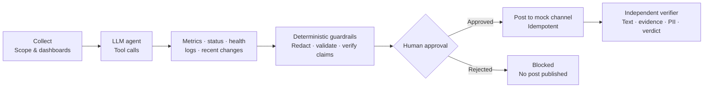

# 🎙️ Incident Voice Status Reporter

During an outage, the on-call lead needs immediate, verified situational awareness without clicking through dozens of fragmented dashboards or risking customer privacy. The **Incident Voice Status Reporter** is an automated SRE briefing agent that collects incident scope, correlates fresh signals across Grafana dashboards, status pages, metrics, and logs, and speaks a concise voice status brief while drafting an update for the team channel. The agent explicitly declares uncertainty when signals are cached, stale, or conflicting, automatically masks sensitive customer data (PII) before display or speech, strictly gates all outbound actions behind human approval, and independently verifies that every claim links directly to a verifiable dashboard ID.

> [!NOTE]
> **Simulated & Synthetic Data Notice:** All telemetry sources (Grafana dashboards, status pages, health probes, deployment records, and error logs) and customer identity data are **synthetic mock records**. The agent sends only redacted synthetic evidence to the configured LLM provider. Without a provider key the application works in deterministic Rules fallback mode.

---

## 🏗️ Architecture & Workflow



1. **Collect**: Validates stable incident identifier, scope text (typed or dictated via browser SpeechRecognition), and target monitoring dashboards.
2. **Plan & Find**: Pulls telemetry from status pages, metrics, and logs. Associates retrieval timestamps, computes age, detects edge caches, and sanitizes PII.
3. **Correlate & Evaluate**: Explicit rule-based decision engine determines operational status (`DEGRADED`, `UNCERTAIN`, `RECOVERED`).
4. **Voice Brief & Proposed Post**: Produces an audio brief (using browser SpeechSynthesis) where every claim cites its supporting dashboard ID `[SIG-xxx]`.
5. **Human Approval Gate (Act)**: Operator reviews proposed destination (`#incident-response`) and exact text. Retrying an approved post triggers an idempotency guard preventing duplicate spam.
6. **Independent Verification (Check)**: Separately re-reads the channel to confirm post existence, exact content fidelity, dashboard signal ID linkage, and zero unredacted PII.

### Agent mode and evidence tools

The LLM is an actual provider-backed synthesis agent when `LLM_API_KEY` is configured. `LLM_PROVIDER=gemini` uses the pinned `google-genai` SDK; `LLM_PROVIDER=openai_compat` uses a configured chat-completions endpoint at `LLM_BASE_URL`. The server gathers all five read-only evidence tools locally in one batch, records each tool observation in the trace, and sends the combined evidence in one model request. A guardrail repair can make one additional request.

| Tool | Synthetic source |
|---|---|
| `get_dashboard_metrics` | Grafana-style error rate, latency, saturation |
| `get_status_page` | Status page state and update time |
| `get_health_check` | Health probe and failure state |
| `get_logs` | Log summaries redacted before model context |
| `get_recent_changes` | Deployment/configuration changes |

The tool loop has a six-step cap, per-request timeout, a 25-second overall budget, and one provider retry. A rejected proposal gets one repair attempt; a second rejection or provider failure is clearly labeled as Rules fallback. Trace rows store tool arguments, observations, latency, and guardrail outcomes. "Thought summaries" are fixed safety-oriented summaries; private chain-of-thought is not requested or stored.

Confidence is deterministic rather than model-selected: `0.65 × fresh-signal ratio + 0.25 × cross-source agreement + 0.10 × required-source coverage` (metrics, health, logs). The UI displays this formula alongside the score.

---

## ⚖️ Operational Decision Rules

| Condition | Evaluated Signals | Resulting State | System Rationale & Behavior |
|:---|:---|:---:|:---|
| **Cached Signal** | Any signal with `is_cached = True` | **`UNCERTAIN`** | Explicitly states: *"This is not proof of recovery."* Edge-cache hits cannot verify active system health. |
| **Stale Signal** | Signal age $> 300$ seconds (5 minutes) | **`UNCERTAIN`** | Telemetry is outdated; state is uncertain until fresh metrics arrive. |
| **Missing Evidence** | Required metric or health probe absent | **`UNCERTAIN`** | Never guesses. If required evidence is missing, returns uncertain. |
| **Unavailable Log Source** | Log evidence is absent | **`UNCERTAIN`** | Missing evidence is called out rather than treated as a clean result. |
| **Failing Health Probe** | Health check fails (e.g. 500/503), even if metrics are green | **`UNCERTAIN`** | Explicitly states: *"Recovery uncertain."* Probe failures override low error rates. |
| **Degraded Telemetry** | All signals fresh, probe passing, error rate $> 1.0\%$ | **`DEGRADED`** | System is actively impaired and experiencing elevated errors. |
| **Full Recovery** | All signals fresh, probe passing, error rate $\le 1.0\%$ | **`RECOVERED`** | All telemetry normal, verified, and healthy. |

---

## 🧪 Official Test Cases Matrix (TC1 to TC4)

The four official cases plus Mixed Signals and Missing Evidence are reproducible:

| Test Case | Scenario | Input Description | Expected Result | Actual Result | Traceable Evidence |
|:---|:---|:---|:---|:---|:---|
| **TC1** | **Status update** | Scope: Checkout 500 errors<br>Signals: 14.8% error rate, 920ms latency, Outage status | Voice brief begins with timestamp; claims cite dashboard IDs; state is `DEGRADED`. | Brief starts with `At HH:MM:SS UTC`; citations `[SIG-METRIC-ERR]`, `[SIG-STAT-01]`; state: `DEGRADED`. | 5 fresh signals with updated timestamps. |
| **TC2** | **Cached dashboard** | Scope: Post-restart recovery<br>Signals: 0.1% error rate with `is_cached = True` | State is `UNCERTAIN`; outputs *"not proof of recovery"*. | State: `UNCERTAIN`; voice brief and post declare *"This is not proof of recovery."* | Cache flag detected on `SIG-METRIC-ERR` (age > 400s). |
| **TC3** | **Customer data in logs** | Scope: Payment failure logs<br>Logs: Contains emails, phone numbers, credit cards | Sensitive data replaced with `[REDACTED_*]` across all surfaces. | Emails, phones, cards masked into `[REDACTED_*]`; 0 raw PII leaked in brief, post, or database rows. | Regex sanitizer masked 4 PII occurrences before storage. |
| **TC4** | **Health check failing** | Scope: Post-failover check<br>Signals: 0.2% errors (green), but DB probe fails (503) | State is `UNCERTAIN`; brief says *"recovery uncertain"*. | State: `UNCERTAIN`; voice brief and post declare *"recovery uncertain"*. | Deep probe `SIG-HLTH-01` returned HTTP 503 replica lag. |
| **MIXED** | **Mixed signals** | Elevated metrics but status page says resolved | `DEGRADED`; explain conflict | Fresh error-rate metric overrides the status page claim | `SIG-METRIC-ERR` and `SIG-STAT-01` |
| **MISSING** | **Missing evidence** | Log source unavailable | `UNCERTAIN`; explain missing source | Missing-log rule forces uncertainty | No log signal returned by `get_logs` |

---

## 🛡️ Safety & Security Principles

- **100% Mock & Synthetic Data**: All metrics, endpoints, deployment events, and customer data are generated synthetic examples. Only redacted mock telemetry is sent to a configured LLM provider.
- **Privacy & PII Protection**: Regex-based redaction engine executes at ingestion time. Emails (`[REDACTED_EMAIL]`), phone numbers (`[REDACTED_PHONE]`), and payment cards (`[REDACTED_CARD]`) are masked *before* speech, display, or database writes.
- **Mandatory Human Approval**: The agent cannot post autonomously. An operator must click `Approve`. A rejected update publishes nothing.
- **Idempotency & Duplicate Prevention**: Outbound messages are hashed via SHA-256 `hash(incident_id + message)`. Retrying an approval executes safely without creating duplicate posts in the channel.
- **No CAPTCHA / OTP Bypass**: The system operates purely on permitted internal telemetry and never attempts to bypass security controls or authentication gates.
- **Transparent Verification**: Independent verification runs post-action and keeps any pending or failed checks visible.

---

## 🚀 Setup & Execution

### Prerequisites
- Python 3.11+
- Chrome or Microsoft Edge (recommended)

> [!IMPORTANT]
> **Browser Speech API Compatibility:** In-browser Speech-to-Text (`SpeechRecognition`) and Text-to-Speech (`speechSynthesis`) require **Google Chrome** or **Microsoft Edge** running over `localhost` or an `HTTPS` connection.

### 1. Installation
```bash
# Clone the repository and enter directory
cd voice

# Install pinned dependencies
pip install -r requirements.txt
```

### 2. Environment Configuration
```bash
# Copy template (optional, sensible defaults apply automatically)
cp .env.example .env
```
| Variable | Default | Description |
|---|---|---|
| `LLM_PROVIDER` | `gemini` | `gemini` or `openai_compat` |
| `LLM_API_KEY` | empty | Provider key; keep it in Render Secrets, never in source |
| `LLM_MODEL` | `gemini-2.5-flash` | Model name. Gemini's model guide lists this as a low-latency, price-performance model. |
| `LLM_BASE_URL` | empty | Required for an OpenAI-compatible endpoint; base URL without `/chat/completions` |
| `LLM_TIMEOUT_SECONDS` | `12` | Per-provider request timeout; overall agent budget is 25 seconds |
| `LLM_FALLBACK_PROVIDER` | empty | Optional `openai_compat` provider used only on primary quota errors |
| `LLM_FALLBACK_API_KEY` | empty | API key for the quota failover provider |
| `LLM_FALLBACK_MODEL` | empty | Failover model identifier |
| `LLM_FALLBACK_BASE_URL` | empty | Failover OpenAI-compatible base URL |
| `DB_PATH` | `incident_reporter.db` | Writable SQLite location; configure a Render disk path for persistence |
| `DEFAULT_CHANNEL` | `#incident-response` | Mock channel only |
| `DEMO_MODE` | `false` | Replays one validated recorded response per scenario; never makes a live request |
| `RECORD_LLM` | `false` | Saves validated live responses by scenario to the recordings JSON file |
| `LLM_RECORDINGS_PATH` | `data/llm_recordings.json` | Path used for recorded-response replay |
| `CORS_ALLOW_ORIGINS` | empty | Comma-separated origins; CORS is off unless configured |
| `HOST`, `PORT` | `0.0.0.0`, platform-provided | Server bind address and port |

### 3. Run Pytest Suite
```bash
pytest -v
```
The pytest suite is offline: provider calls are mocked, and each test gets an isolated SQLite database. The `/api/run-tests` runner executes TC1-TC4 plus Mixed and Missing through the full pipeline, labels its approval simulation as test-only, and reports PASS only when assertions and independent verification pass. Live model requests are off by default in the test runner; enable the UI's **Run with live LLM** option only when intended. With `DEMO_MODE=true`, the runner uses matching recorded responses when available and falls back to deterministic rules otherwise.

Identical analysis inputs are cached for ten minutes, and the UI labels cache hits. On a Gemini quota error, `LLM_FALLBACK_PROVIDER=openai_compat` can route the request through the separately configured fallback credentials/model/base URL before rules fallback. Provider diagnostics stay in server logs; only a short quota status is shown in the UI.

### 4. Start Server
```bash
uvicorn app.main:app --host 0.0.0.0 --port 8000 --reload
```
Open your browser at: **[http://localhost:8000](http://localhost:8000)**. With no `LLM_API_KEY`, the mode badge reads **Rules fallback**; with valid provider settings it reads **LLM agent**.

*(The SQLite database is created and pre-seeded automatically on first start with no manual steps required).*

---

## ☁️ Deployment Instructions

The application is cloud-ready and includes container and process manifests:

### Render / Railway / Heroku
A [`Procfile`](file:///c:/Users/ps213/OneDrive/Desktop/voice/Procfile) is provided:
```
web: uvicorn app.main:app --host 0.0.0.0 --port $PORT
```
Health check endpoint: `GET /health` returns `{"status": "ok"}`. For Gemini, set `LLM_PROVIDER=gemini`, `LLM_API_KEY` (Render secret), `LLM_MODEL=gemini-2.5-flash`, and optionally `LLM_TIMEOUT_SECONDS=12`. For OpenAI-compatible services set `LLM_PROVIDER=openai_compat`, `LLM_API_KEY`, `LLM_BASE_URL`, and `LLM_MODEL`. Set `DB_PATH` to a writable persistent-disk location if SQLite state must survive Render restarts.

### Docker / Hugging Face Spaces
Build and run using the [`Dockerfile`](file:///c:/Users/ps213/OneDrive/Desktop/voice/Dockerfile) (`python:3.11-slim`):
```bash
docker build -t incident-voice-reporter .
docker run -p 8000:8000 incident-voice-reporter
```

---

## 🎬 3-Minute Demo Walkthrough for Judges

Follow this rapid step-by-step script at `http://localhost:8000`:

1. **TC1 — Status Update (Timestamps & Linked Claims)**:
   - Click **`TC1: Status Update`** $\rightarrow$ Click **`⚡ Collect Signals & Plan Voice Brief`**.
   - Show that status is **`DEGRADED`** (error rate 14.8%).
   - Point out that the voice brief begins with an exact UTC timestamp (`At HH:MM:SS UTC, incident voice update for...`).
   - Show that each claim in the matrix links to its dashboard ID (`[SIG-METRIC-ERR]`, `[SIG-STAT-01]`).
   - Click **`🔊 Read Aloud`** to demonstrate browser TTS with the audio wave animation.

2. **TC2 — Cached Dashboard ("Not Proof of Recovery")**:
   - Click **`TC2: Cached Dashboard`** $\rightarrow$ Click **`⚡ Collect Signals & Plan Voice Brief`**.
   - Show that even though errors are 0.1%, the edge cache flag causes state **`UNCERTAIN`**.
   - Point out explicit warning: **`"This is not proof of recovery."`**

3. **TC4 — Health Check Failing ("Recovery Uncertain")**:
   - Click **`TC4: Health Check Failing`** $\rightarrow$ Click **`⚡ Collect Signals & Plan Voice Brief`**.
   - Show that metrics look green (0.2%), but failing DB replication probe forces state **`UNCERTAIN`**.
   - Point out explicit warning: **`"Recovery uncertain."`**

4. **TC3 — Customer Data in Logs (Automated Redaction)**:
   - Click **`TC3: Customer Data in Logs`** $\rightarrow$ Click **`⚡ Collect Signals & Plan Voice Brief`**.
   - Show that raw payment exception logs contain emails, phone numbers, and credit cards.
   - Show that all sensitive tokens are redacted into `[REDACTED_EMAIL]`, `[REDACTED_PHONE]`, `[REDACTED_CARD]` across evidence, voice, proposed post, and database rows.

5. **Try to Trick the Agent**:
   - Select TC2, enable **Try to trick the agent**, and run it.
   - Show the simulated recovery claim rejected by guardrails and the deterministic uncertain brief retained.

6. **Human Approval & Duplicate Post Prevention (Idempotency)**:
   - Review proposed update for `#incident-response`.
   - Click **`✅ Approve & Post`** $\rightarrow$ message publishes to the Mock Channel Feed and independent verification reports **`PASS 4/4`**.
   - Click **`🔄 Retry (Test Idempotency)`** $\rightarrow$ show duplicate alert; duplicate channel spam is blocked.

7. **Speech Dictation & Test Matrix**:
   - Click **`🎙️ Dictate`** to demonstrate speech-to-text in the scope field (editable live).
   - Click **`▶️ Run All Official Test Cases`** to show the six-scenario execution matrix, including test-only approval and verification results.
   - Download the run's evidence pack from the console.

---

## Known limitations

- Telemetry sources and the channel are synthetic; the app does not connect to production dashboards or post to a real chat service.
- Provider integration is exercised with mocked clients in pytest. Configure a provider key and verify its quota, model access, and endpoint in your deployment before a live demo.
- Demo recordings are stored in a JSON file and must be placed on persistent storage to survive deployment restarts. Only accepted, guardrail-passing live outputs are recorded.
- Agent progress is shown after the synchronous run completes; the current UI does not stream intermediate model/tool steps over SSE.
- SQLite on ephemeral hosting is not durable without a mounted persistent disk.
- Browser microphone and speech output depend on browser support and HTTPS/localhost. Visible text remains available if audio is unavailable.

---

## 📄 License
MIT License. Created for the Incident Voice Status Reporter Hackathon.
